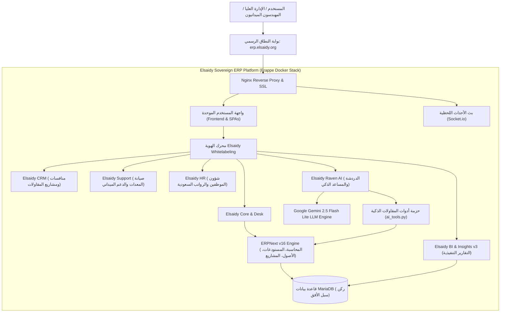

# Elsaidy ERP | نظام الصعيدي لتخطيط وإدارة موارد المقاولات 🏗️

[](https://erp.elsaidy.org)
[](https://erp.elsaidy.org)
[](https://erp.elsaidy.org)
[](https://erp.elsaidy.org)
[](https://erp.elsaidy.org)

> **النسخة المؤسسية السيادية لشركة ركن سبل الأفق للمقاولات العامة (Rkn)**  
> **Enterprise Sovereign ERP & Autonomous AI Contracting Platform**

---

## 📑 فهرس المحتويات | Table of Contents
1. [نظرة عامة على النظام | Executive Overview](#-نظرة-عامة-على-النظام--executive-overview)
2. [مصفوفة التفوق: Elsaidy ERP مقابل دفترة (Daftra) والميزان (Al-Mizan)](#-مصفوفة-التفوق-على-الأنظمة-المنافسة-دفترة-والميزان)
3. [معمارية النظام ومنظومة التطبيقات المتكاملة | System Architecture](#-معمارية-النظام-والتطبيقات-المدمجة)
4. [حزمة المقاولات السعودية المتقدمة (Saudi Contracting Suite)](#-حزمة-المقاولات-السعودية-المتقدمة)
   - [شجرة الحسابات والضرائب المعتمدة من هيئة الزكاة (ZATCA COA)](#1-شجرة-الحسابات-المتخصصة-والضرائب-الزكوية)
   - [إدارة المستخلصات ومحجوز الضمان (IPC & Retention)](#2-نظام-المستخلصات-الإنشائية-وحسم-الدفعة-المقدمة-ومحجوز-الضمان-ipc)
   - [إدارة مسار منافسات منصة اعتماد (Etimad Contracting CRM)](#3-خط-أنابيب-المنافسات-والمشاريع-etimad-crm-pipeline)
   - [الدعم الميداني وصيانة الآليات الثقيلة (Field Operations & Equipment Support)](#4-إدارة-المعدات-الثقيلة-والصيانة-الميدانية-helpdesk)
   - [الامتثال العمالي السعودي (Saudi HR & Labor Compliance)](#5-الامتثال-العمالي-والمهني-saudi-hr-compliance)
5. [المساعد الذكي المستقل Raven AI (Gemini 2.5 Flash Lite)](#-المساعد-الذكي-المستقل-raven-ai-ecosystem)
6. [لوحات القيادة التنفيذية الذكية (Insights v3 Executive Dashboards)](#-لوحات-القيادة-التنفيذية-insights-v3-bi)
7. [محرك الهوية المؤسسية الكاملة (100% White-Labeling & Auto-Dismiss Engine)](#-محرك-الهوية-المؤسسية-100-white-labeling)
8. [دليل التثبيت والتشغيل والتطهير الشامل (Deployment & Sanitization Guide)](#-دليل-التثبيت-والتشغيل-والصيانة-devops)

---

## 🏛️ نظرة عامة على النظام | Executive Overview

يمثل **نظام الصعيدي للمقاولات (Elsaidy ERP)** قفزة نوعية في إدارة وتخطيط موارد شركات المقاولات العامة والإنشاءات في المملكة العربية السعودية. تم بناء وتطوير النظام ليعمل كمنصة سحابية سيادية متكاملة ومؤتمتة بالكامل، مستندة إلى أحدث إصدارات **Frappe Framework v16** و **ERPNext v16** مع دمج عميق ومباشر للذكاء الاصطناعي التوليدي **Google Gemini AI**.

تمت تهيئة وتوطين النظام خصيصاً لتلبية المتطلبات المالية والهندسية والإدارية لـ **شركة ركن سبل الأفق للمقاولات العامة (Rkn)** تحت النطاق الرسمي:
👉 [https://erp.elsaidy.org](https://erp.elsaidy.org)

---

## ⚔️ مصفوفة التفوق على الأنظمة المنافسة: دفترة والميزان

| المعيار والميزة | نظام الصعيدي للمقاولات (Elsaidy ERP) | برنامج دفترة (Daftra) | برنامج الميزان (Al-Mizan) |
| :--- | :--- | :--- | :--- |
| **محرك الذكاء الاصطناعي (AI)** | **مساعد ذكي توليدي تفاعلي (Raven AI + Gemini 2.5 Flash Lite)** ينفذ القيود، يسوي العهد، ويحلل المشاريع باللغة العربية الطبيعية. | إما غير موجود نهائياً أو مقتصر على روبوتات محادثة نصية بدائية تكرر نصوص مساعدة. | غير موجود نهائياً (نظام ديسكتوب محاسبي تقليدي بدون ذكاء اصطناعي). |
| **تسوية عهد المهندسين الميدانيين** | **تسوية ذكية فورية عبر الدردشة/واتساب في 30 ثانية** مع فصل تلقائي لضريبة القيمة المضافة 15% وتوجيه المصروف وتوليد رابط فوري للقيد. | يتطلب إدخال يدوي معقد لكل بند وفاتورة عبر نماذج محاسبية مطولة. | يتطلب إدخال قيود محاسبية يدوية في شاشات سطح المكتب. |
| **إدارة المستخلصات الإنشائية (IPC)** | **نظام مستخلصات متكامل** يدعم رقم المستخلص، نسبة وقيمة حسم الدفعة المقدمة، ونسبة ومحجوز ضمان حسن التنفيذ، مع قيد تلقائي لمحجوز الضمان. | فواتير مبيعات تقليدية تفتقر لمعادلات حسم الدفعة المقدمة ومحجوز الضمان التلقائي. | شاشات مقاولات غير متصلة تلقائياً بالضريبة والربط الزكوي السحابي. |
| **لوحات القيادة وتحليل الأعمال (BI)** | **محرك Insights v3 الحي المتطور** بدقة OLAP فورية، رسوم دائرية، بارات مقارنة، وبطاقات أداء حية بدون برامج وسيطة. | تقارير ورقية وجداول بيانية مسطحة وبطيئة في التحديث وتفتقر للمرونة. | تقارير تقليدية تطبع على ورق أو PDF دون تفاعلية حية أو لوحات تحكم ديناميكية. |
| **منظومة بيئية موحدة (Unified)** | **منصة سيادية واحدة تضم 10 تطبيقات:** (ERP, HR, CRM, Helpdesk, Insights, Raven Chat, Builder, Wiki, Telephony, WhatsApp). | منصة محاسبية أساسية مع وظائف محدودة تفرض تكاليف إضافية لكل إضافة وتكامل خارجي. | نظام محاسبي منفصل تماماً عن إدارة الموارد البشرية وخدمة العملاء ودردشة الفريق. |
| **إدارة علاقات عملاء المقاولات (CRM)** | **خط أنابيب مخصص لمناقصات منصة اعتماد الحكومية** (شراء كراسة الشروط ➔ حصر الكميات ➔ التقديم ➔ الترسية ➔ التعميد). | مسار مبيعات تجاري تقليدي لا يفهم دورة حياة المناقصات والمستخلصات الحكومية. | غير موجود أو ضعيف جداً ولا يلائم طبيعة الشركات الهندسية والمناقصات. |
| **الامتثال للأنظمة السعودية** | **تطابق 100% مع ZATCA المرحلة الثانية، منصة قوى، مدد، والتأمينات الاجتماعية (GOSI)** مع تتبع الإقامات والتأمين المهني SVP. | دعم ضريبي عام للفوترة الإلكترونية دون تتبع تراخيص الموظفين والمعدات ونسب السعودة بدقة. | يدعم الفواتير التقليدية مع صعوبة في التحديثات السحابية للمتطلبات الحكومية المستجدة. |
| **السيادة التامة على البيانات** | **بيانات المؤسسة مملوكة بنسبة 100% ومستضافة على خوادم خاصة سحابية** مع تحكم كامل بالكود المصدري وقواعد البيانات. | بيانات الشركة مستضافة لدى مزود الخدمة ومشفرة بتنسيق مغلق مع إمكانية انقطاع الخدمة أو تغيير الأسعار. | قواعد بيانات محلية عرضة للتلف والفيروسات وفقدان النسخ الاحتياطية. |
| **التكلفة والرسوم الدورية** | **رسوم ملكية منعدمة** (بدون اشتراك شهري لكل مستخدم)، مستخدمين غير محدودين، واستثمار استراتيجي دائم. | اشتراكات شهرية/سنوية متصاعدة تزداد مع كل مستخدم إضافي وكل تطبيق. | رسوم ترخيص سنوية ورسوم باهظة لكل جهاز كمبيوتر إضافي. |

---

## 🏢 معمارية النظام والتطبيقات المدمجة



---

## 🏗️ حزمة المقاولات السعودية المتقدمة

### 1. شجرة الحسابات المتخصصة والضرائب الزكوية
تمت هندسة دليل الحسابات الخاص بالشركة ليطابق المتطلبات المحاسبية للمقاولات السعودية مع إنشاء الحسابات الحيوية التالية:
* **حسابات المصروفات المباشرة للمشاريع (Direct Job Costs - 5100):**
  - `5120 - مصروف الوقود والمحروقات - Rkn`
  - `5130 - صيانة وإصلاح السيارات والمعدات - Rkn`
  - `5140 - إيجار معدات وآليات ثقيلة - Rkn`
  - `5150 - مواد ومهمات تشغيل المشاريع - Rkn`
  - `5160 - أعمال مقاولي الباطن - Rkn`
  - `5170 - ضيافة وإعاشة مواقع - Rkn`
* **الحسابات الزكوية والضريبية المعتمدة (ZATCA VAT 15%):**
  - `2330 - ضريبة القيمة المضافة للمخرجات 15% - Rkn`
  - `1510 - ضريبة القيمة المضافة للمدخلات 15% - Rkn`
  - قالب الضرائب القياسي الافتراضي: `ضريبة القيمة المضافة السعودية 15% - Rkn`.
* **حسابات العهد والضمانات البنكية ومحجوز الضمان:**
  - `1120 - عهد نقدية للمهندسين والمشرفين - Rkn`
  - `1320 - محجوزات ضمان حسن التنفيذ للعملاء (Retention Receivable) - Rkn`
  - `2130 - محجوزات ضمان مقاولي الباطن (Retention Payable) - Rkn`

### 2. نظام المستخلصات الإنشائية وحسم الدفعة المقدمة ومحجوز الضمان (IPC)
تحتوي كل من فواتير المبيعات (`Sales Invoice`) وفواتير المشتريات ومقاولي الباطن (`Purchase Invoice`) على حقول مخصصة للمستخلصات الإنشائية:
- **نوع المستخلص:** أولي، دوري، ختامي، تسوية نهائية.
- **رقم المستخلص وقيمة العقد الإجمالي:** لحساب التراكمي ومقارنته بالموازنة.
- **حسم الدفعة المقدمة (Advance Deduction):** نسبة مئوية ومبلغ يتم خصمه مباشرة من صافي المستخلص.
- **محجوز ضمان حسن التنفيذ (Retention Deduction):** نسبة مئوية (عادة 5% أو 10%) تخصم من قيمة الأعمال المنفذة وتوجه لحساب محجوزات الضمان تلقائياً.
- **نماذج طباعة معتمدة:**
  - `مستخلص أعمال مقاولات معتمد - Sales Invoice`
  - `مستخلص أعمال مقاولات معتمد - Purchase Invoice`
  - `Elsaidy Saudi Contracting Invoice` (فاتورة ضريبية متوافقة كلياً مع كود QR لهيئة الزكاة ZATCA).

### 3. خط أنابيب المنافسات والمشاريع (Etimad CRM Pipeline)
تم تخصيص مسار العملاء والفرص البيعية داخل **Elsaidy CRM** ليطابق مراحل دورة ترسية المناقصات والمشاريع الإنشائية:
1. `فرصة جديدة / منصة اعتماد`
2. `شراء ودراسة كراسة الشروط`
3. `حصر الكميات والتسعير الفني والمالي`
4. `تقديم العرض الفني والمالي`
5. `الترسية المبدئية والتفاوض`
6. `تم التعميد وتوقيع العقد (Won)`
7. `مغلق / لم يرسُ (Lost)`

### 4. إدارة المعدات الثقيلة والصيانة الميدانية (Helpdesk)
فرق دعم متخصصة ومربوطة بمسؤولي النظام:
- **الدعم التقني ونظام Elsaidy ERP**
- **إدارة المعدات والآليات الثقيلة**
- **دعم المشاريع والمواقع الميدانية**  
مع تصنيفات بلاغات تضمن سرعة الاستجابة الميدانية:
- `عطل معدة أو آلية بالموقع`
- `طلب مواد أو مهمات عاجلة`
- `ملاحظة سلامة وجودة ميدانية (HSE)`
- `دعم تقني أو محاسبي`

### 5. الامتثال العمالي والمهني (Saudi HR Compliance)
حقول مخصصة لبطاقة الموظف تضمن التوافق التام مع لوائح وزارة الموارد البشرية ومنصة قوى:
- رقم وتاريخ انتهاء الإقامة / الهوية الوطنية (مع تنبيهات التجديد).
- رقم شهادة الاعتماد المهني والفحص المهني (SVP Certificate).
- رقم الاشتراك في التأمينات الاجتماعية (GOSI).
- تاريخ انتهاء وثيقة التأمين الطبي الشامل للعمالة.

---

## 🤖 المساعد الذكي المستقل (Raven AI Ecosystem)

يعمل المساعد الذكي داخل منصة Elsaidy ERP عبر محرك **Google Gemini 2.5 Flash Lite** مع توفير مجموعة متكاملة من الروبوتات والأدوات البرمجية المتخصصة:

### 1. الروبوتات المتخصصة (Specialized Bots)
* **المحاسب الذكي (Accounting Bot):** يمتلك 15 وظيفة ذكية، يجيب بدقة على شجرة الحسابات، موازين المراجعة، الأستاذ العام، إنشاء القيود، وتسوية العهد.
* **روبوت المبيعات والمستخلصات (Sales Bot):** يتابع عروض الأسعار، أوامر البيع، وفواتير المستخلصات.
* **روبوت المستودعات والمواد (Inventory Bot):** مراقبة مستويات المخزون، مواد التشغيل، وتوفر المعدات.
* **روبوت إدارة المشاريع (Projects Bot):** متابعة نسب إنجاز المواقع وتكاليف المراحل الإنشائية.
* **روبوت الموارد البشرية (HR Bot):** تتبع رصيد الإجازات، الرواتب، وانتهاء الوثائق الرسمية للموظفين.

### 2. الأدوات البرمجية الحصرية (AI Tools)
* **تسوية عهدة الموقع الميداني (`create_custody_settlement_entry`):**
  يقوم مهندس الموقع بإرسال رسالة عادية للروبوت مثل:
  > *"تم صرف 4,600 ريال من عهدتي: 2,300 وقود معدات و 2,300 صيانة بوكلين شاملة الضريبة"*
  يقوم المساعد الذكي فوراً بما يلي:
  1. حساب صافي المصروف وفصل ضريبة القيمة المضافة (15%) تلقائياً.
  2. إنشاء قيد يومية مسودة (`docstatus=0`) في النظام يوجه الحسابات بدقة:
     - مدين: `5120 - مصروف الوقود والمحروقات - Rkn` (2,000 ريال)
     - مدين: `5130 - صيانة وإصلاح السيارات والمعدات - Rkn` (2,000 ريال)
     - مدين: `1510 - ضريبة القيمة المضافة للمدخلات 15% - Rkn` (600 ريال)
     - دائن: `1120 - عهد نقدية للمهندسين والمشرفين - Rkn` (4,600 ريال)
  3. إرجاع رابط مباشر كامل وقابل للنقر في سطر مستقل:  
     `https://erp.elsaidy.org/app/journal-entry/ACC-JV-2026-00001`
* **الملخص المالي التنفيذي للمشاريع والسيولة (`get_project_financial_summary`):**
  يعيد تقريراً استراتيجياً حياً بالسيولة النقدية، أرصدة البنوك، إجمالي إيرادات ومصروفات المشاريع، محجوزات الضمان المعلقة، والموقف الضريبي التقديري لـ ZATCA.

---

## 📊 لوحات القيادة التنفيذية (Insights v3 BI)

تم تصميم وتفعيل لوحتي قيادة تنفيذيتين فائقتي الدقة حصرياً للمالك والمدير العام في **Insights v3**:

1. **لوحة المالك والمدير العام - الملخص التنفيذي الشامل (Executive CEO Dashboard):**
   - **بطاقة KPI:** رصيد السيولة النقدية والبنكية المتاحة فوراً.
   - **بطاقة KPI:** إجمالي إيرادات المستخلصات والأعمال الإنشائية.
   - **بطاقة KPI:** إجمالي المصروفات التشغيلية والمباشرة للمشاريع.
   - **بطاقة KPI:** إجمالي محجوزات الضمان المعلقة لدى العملاء (Retentions).
   - **رسم بياني (Donut):** توزيع المصروفات المباشرة حسب نوع البند (وقود، صيانة، مقاولو باطن، مواد).
   - **رسم بياني (Bar):** مقارنة الإيرادات بالمصروفات التشغيلية شهرياً.
   - **رسم بياني (Bar):** ربحية المشاريع الإنشائية الجارية والمغلقة.
   - **رسم بياني (Bar):** رصيد المديونيات والمستحقات على جهات الترسية.

2. **التقارير التفصيلية للمشاريع والعهد والزكاة والضريبة (Financial & Tax Operations Dashboard):**
   - **رسم بياني (Donut):** موقف ضريبة القيمة المضافة التقديري (ضريبة المخرجات مقابل ضريبة المدخلات).
   - **رسم بياني (Bar):** أرصدة عهد المهندسين والمشرفين الميدانيين غير المسواة.
   - **رسم بياني (Bar):** تكاليف صيانة وتشغيل الآليات والمعدات الثقيلة.
   - **جدول تحليلي (Table):** سجل حركات الأستاذ العام الحديثة المفصلة بمراكز التكلفة والمشاريع.

---

## 🎨 محرك الهوية المؤسسية (100% White-Labeling)

تم القضاء بنسبة **100%** على أي ظهور لكلمات `Frappe`, `ERPNext`, `Hagag`, `حجاج` أو شعارات المصدر المفتوح:
- **شعار وأيقونة ملكية مخصصة:** لوجو فاخر بالأزرق الملكي والذهبي يجسد شعار وهوية المؤسسة:  
  `/assets/hagag_erp/images/elsaidy_logo.svg` و `/assets/hagag_erp/images/elsaidy_icon.svg`.
- **محرك الإخفاء التلقائي والحقن (Auto-Dismiss & CSS/JS Injection):**  
  إخماد كامل وفوري لكافة إشعارات الترحيب، وجولات الإعداد (Onboarding Tours)، ومكتبات `driver.js` في تطبيقات Desk و CRM و Helpdesk.
- **مراقب شجرة العناصر الحصري (`MutationObserver`):**  
  يعمل في خلفية المتصفح باستمرار لمسح أي نصوص متبقية في الـ DOM أو شريط العناوين وتحويلها فوراً إلى **Elsaidy ERP / شركة ركن سبل الأفق للمقاولات**.
- **اعتراض واستبدال مسارات تطبيقات الـ SPA (`hrms_inject.py`):**  
  حقن ملفات التخصيص السيادية في جميع مسارات `/crm`, `/helpdesk`, `/hrms`, `/insights`, `/raven` قبل إرسال كود HTML للمتصفح.

---

## 🛠️ دليل التثبيت والتشغيل والصيانة (DevOps)

### 1. تزامن الإعدادات التلقائي عبر `bench migrate`
كافة التخصيصات (شجرة الحسابات، الحقول، نماذج الطباعة، لوحات Insights v3، روبوتات Raven) مربوطة تلقائياً بـ `after_migrate` في `hagag_erp/hooks.py`:
```bash
docker compose -f compose.yaml -f compose.custom.yaml -f compose.origin.yaml -f compose.raven.yaml exec -T backend bench --site erp.local migrate
```

### 2. بناء الأصول الثابتة (Asset Compilation)
```bash
docker compose -f compose.yaml -f compose.custom.yaml -f compose.origin.yaml -f compose.raven.yaml exec -T backend bench build --app hagag_erp
```

### 3. التطهير الآمن لقاعدة البيانات (Database Sanitization Safety Lock)
تم تزويد دالة التطهير بقفل أمان برمجي صارم يمنع تنفيذها على موقع الإنتاج `erp.local`، ويلزم تمرير مفتاح التأكيد الصريح:
```bash
# محمية برمجياً ولا تعمل على موقع الإنتاج حفاظاً على البيانات
bench execute hagag_erp.setup.sanitize_database_test_data --kwargs "{'confirm_token': 'CONFIRM_ERASE_TEST_DATA_ONLY'}"
```

### 4. مسح الكاش وإعادة تشغيل الخدمات
```bash
docker compose -f compose.yaml -f compose.custom.yaml -f compose.origin.yaml -f compose.raven.yaml exec -T backend bench --site erp.local clear-cache
docker compose -f compose.yaml -f compose.custom.yaml -f compose.origin.yaml -f compose.raven.yaml restart backend websocket queue-short queue-long frontend
```

---

## 🏛️ المحرك الضريبي السعودي المركزي وقفل منع التكرار (ZATCA Engine & Idempotency)

### 1. المحرك الضريبي المركزي (`hagag_erp/tax_engine.py`)
- **حسابات دقيقة بدقة `Decimal(0.01 SAR)`** باستخدام تقريب `ROUND_HALF_UP` لمنع أي فروقات كسرية.
- **تطبيق صارم للمادة 50 من اللائحة التنفيذية لضريبة القيمة المضافة (ZATCA):**
  - استبعاد استرداد ضريبة وقود وصيانة المركبات المقيدة (سيارات الركاب الخاصة) ورسملتها بالكامل على حساب المصروف.
  - توجيه ضريبة وقود الآليات والمعدات غير المحددة بدقة أو غير المستوفية للفواتير الضريبية إلى حساب `1520 - ضريبة مدخلات معلقة تحت المراجعة والاعتماد - Rkn`.
  - التحقق من وجود الحسابات التجميعية ومنع إدراج ضريبة المدخلات في الطرف الدائن في قيود المصروفات والمشتريات.
  - خطاف أمان برمجي (`validate_tax_review_before_submit`) يمنع ترحيل أي مستند معلق ضريبياً إلى الأستاذ العام قبل تدقيقه واعتماده.
- **معايير قطاع المقاولات للمستخلصات الإنشائية (IPC):**
  - إثبات أن محجوز ضمان حسن التنفيذ (Retention) لا يخفض الوعاء الضريبي بأي حال.
  - تطبيق قواعد نقطة استحقاق الضريبة الخاصة بالعقود الحكومية (منصة اعتماد) المرتبطة بأمر الدفع أو الاستلام.

### 2. محرك القفل الذري ومنع التكرار (`hagag_erp/idempotency.py`)
- جدول قفل مركزي في قاعدة البيانات (`tabElsaidy Operation Lock`) مدعوم بذاكرة Redis المؤقتة.
- منع تكرار إنشاء المستندات المالية والقيود عند انقطاع الشبكة أو إعادة إرسال الرسائل من قبل المستخدم أو روبوتات المحادثة.
- إعادة نفس المستند المعتمد في حالة تكرار نفس معرف العملية (`operation_id`)، وتوليد مستندات جديدة ومستقلة عند اختلاف النية.

### 3. نتائج حزمة الاختبارات المعزولة المعتمدة (`tests_zatca_engine.py`)
تم تنفيذ حزمة الاختبارات بالكامل داخل بيئة الاختبار المستقلة (`erp_test.local`) وحققت نسبة نجاح **100% (6 / 6)**:
1. `Test 1`: توجيه بنزين محطة وقود غير محدد المركبة إلى حساب 1520 وحظر الترحيل نظامياً ✅
2. `Test 2`: توجيه ديزل المعدات الثقيلة (بوكلين) بفاتورة ضريبية إلى حساب 1510 المسترد ✅
3. `Test 3`: رسملة ضريبة سيارات الركاب الخاصة على المصروف واستبعادها من 1510 ✅
4. `Test 4`: حساب المبالغ غير الشاملة (230 net + 34.50 vat = 264.50 gross) بدقة Decimal ✅
5. `Test 5`: التحقق من منع التكرار الذري (Idempotency Key) والتفريق بين الطلبات المتطابقة والطلبات المستقلة ✅
6. `Test 6`: حساب مستخلص المقاولات وإثبات أن محجوز الضمان لا يخفض الوعاء الضريبي وتطبيق اشتراطات منصة اعتماد ✅

---

---

<div align="center">
  <sub>تم التطوير والهندسة المعمارية بواسطة <b>فريق التطوير المؤسسي لنظام Elsaidy ERP</b> لصالح <b>شركة ركن سبل الأفق للمقاولات</b>.</sub><br>
  <sub>All Rights Reserved © 2026 Elsaidy ERP | Rkn Contracting Co.</sub>
</div>
