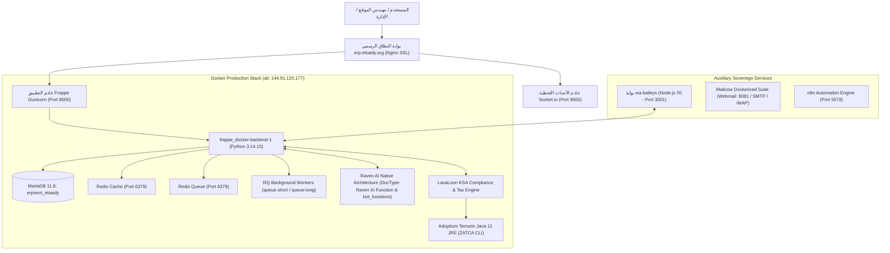

# Elsaidy ERP | نظام الصعيدي لتخطيط وإدارة موارد المقاولات 🏗️

[](https://erp.elsaidy.org)
[](https://erp.elsaidy.org)
[](https://erp.elsaidy.org)
[](https://erp.elsaidy.org)
[](https://erp.elsaidy.org)
[](https://erp.elsaidy.org)
[](https://erp.elsaidy.org)

> **المنظومة المؤسسية السيادية لإدارة موارد قطاع المقاولات العامة والإنشاءات**  
> **الجهة المالكة المعتمدة:** شركة ركن سبل الأفق المحدودة (`ركن سبل الافق` | Abbreviation: `Rkn`)  
> **بوابة النطاق الرسمي للإنتاج:** [https://erp.elsaidy.org](https://erp.elsaidy.org) (موقع `erp.local`)

---

## 📑 فهرس المحتويات | Table of Contents
1. [نظرة عامة على النظام والجهة المالكة | Executive Overview](#-نظرة-عامة-على-النظام-والجهة-المالكة)
2. [مصفوفة التفوق التنافسي: Elsaidy ERP مقابل دفترة والميزان](#-مصفوفة-التفوق-التنافسي)
3. [معمارية النظام ومنظومة التطبيقات المثبتة | System Architecture](#-معمارية-النظام-ومنظومة-التطبيقات)
4. [حزمة المقاولات السعودية المتقدمة (Saudi Contracting Suite)](#-حزمة-المقاولات-السعودية-المتقدمة)
   - [دليل الحسابات المتخصص والحسابات البنكية (CoA)](#1-دليل-الحسابات-المتخصص-والحسابات-البنكية)
   - [إدارة المستخلصات ومحجوز الضمان والتحصيل (Contracting IPCs)](#2-إدارة-المستخلصات-وحسم-الدفعة-المقدمة-ومحجوز-الضمان-ipc)
   - [تطبيق المادة 50 من لائحة الزكاة والضريبة (Article 50 VAT Recovery)](#3-تطبيق-المادة-50-من-لائحة-الزكاة-والضريبة)
   - [دورة العهد النقدية للمهندسين والسلف والرواتب (Custody & Payroll)](#4-دورة-العهد-النقدية-للمهندسين-والسلف-والرواتب)
5. [المساعد الذكي المحاسبي المستقل (Raven AI Architecture)](#-المساعد-الذكي-المحاسبي-المستقل-raven-ai)
6. [مركز قيادة واتساب الميداني (WhatsApp Hub & Security Allowlist)](#-مركز-عمليات-واتساب-الميداني-whatsapp-hub)
7. [الفوترة الإلكترونية لهيئة الزكاة - المرحلة الثانية (ZATCA Phase 2)](#-الفوترة-الإلكترونية-لهيئة-الزكاة-zatca-phase-2)
8. [سجل نتائج الاختبارات وضمان الجودة (Test Results & Quality Gates)](#-سجل-نتائج-الاختبارات-وضمان-الجودة)
9. [دليل النشر والترقية وخطة التراجع (Deployment & Rollback Guide)](#-دليل-النشر-والترقية-وخطة-التراجع)

---

## 🏛️ نظرة عامة على النظام والجهة المالكة

يمثل **نظام الصعيدي للمقاولات (Elsaidy ERP)** منصة تخطيط وإدارة موارد سحابية سيادية مخصصة لقطاع الإنشاءات والمقاولات في المملكة العربية السعودية، تعمل بأحدث إصدارات بيئة **Frappe Framework v16** و **ERPNext v16**، مستندة إلى قاعدة بيانات **MariaDB 11.8** ومحرك بايثون الموحد **Python 3.14.10**.

### السجل المؤسسي للشركة المعتمدة (Target Legal Entity):
- **اسم الشركة في النظام:** `ركن سبل الافق` (معروفة تجارياً بـ *شركة ركن سبل الأفق للمقاولات*).
- **رمز الاختصار (Abbreviation):** `Rkn`.
- **الدولة والعملة الافتراضية:** المملكة العربية السعودية (`Saudi Arabia`) | الريال السعودي (`SAR`).
- **الحساب البنكي المعتمد للعمليات:** `1201 - البنك الأهلي السعودي (SNB) - Rkn`.
- **الصندوق النقدي الرئيسي:** `1110 - نقد - Rkn`.
- **حساب العهد النقدية:** `1120 - عهد نقدية للمهندسين والمشرفين - Rkn`.
- **حساب السلف الشخصية:** `1610 - سلف مؤقتة للعاملين - Rkn`.
- **الرقم الضريبي (VAT ID):** حقل مسجل في بطاقة الشركة، ومستعد للربط المباشر مع منصة الفاتورة فور إصدار رمز OTP للمنشأة.

---

## ⚔️ مصفوفة التفوق التنافسي

| المعيار الهندسي والتشغيلي | نظام الصعيدي للمقاولات (Elsaidy ERP) | برنامج دفترة (Daftra) | برنامج الميزان (Al-Mizan) |
| :--- | :--- | :--- | :--- |
| **المساعد الذكي (AI Assistant)** | **Raven AI + Gemini 2.5 Flash Lite**؛ يفهم اللغة العربية الطبيعية، ينفذ معاينات القيود، يسوي العهد، ويمنع الهلوسة المحاسبية. | روبوتات دردشة محدودة تقتصر على نصوص الدعم الفني وتفتقر للتنفيذ المالي. | غير متوفر نهائياً (نظام مكتبي تقليدي). |
| **تسوية العهد الميدانية** | **تسوية في 30 ثانية عبر واتساب/المساعد الذكي** مع فصل تلقائي لضريبة ZATCA وربط الموظف وتوليد رابط مباشر للقيد. | إدخال يدوي طويل عبر شاشات القيود التقليدية. | قيود يومية مكتبية يدوية وتأخير في تسوية فواتير المواقع. |
| **مستخلصات المقاولات (IPC)** | **محرك IPC متكامل** يحسب التراكمي، خصم الدفعة المقدمة، محجوز الضمان (10% تجاري / 5% حكومي)، مع إثبات عدم تخفيض الوعاء الضريبي. | فواتير مبيعات عامة تفتقر لمعادلات محجوز الضمان والدفعة المقدمة التلقائية. | معالجات منفصلة غير مربوطة بالربط السحابي والفوترة التلقائية. |
| **الأمن السيبراني وقائمة السماح** | **Strict Allowlist + Silent Drop**؛ إسقاط صامت للمرسلين غير المصرح لهم دون كشف وجود البوت أو تسريب بيانات. | فتح الرسائل العامة مع مخاطر الردود التلقائية غير المرغوبة. | لا يحتوي على تكامل مع واتساب أو بوابات دردشة. |
| **الامتثال للمادة 50 (ZATCA)** | **فصل آلي بنسبة 100%** لوقود الآليات والمعدات التجارية (حساب 1510) مقابل رسملة سيارات الركاب الخاصة على المصروف. | إدخال الضريبة بنسبة ثابتة دون تمييز قيود الأهلية النظامية للمركبات. | معالجة ضريبية تقليدية تتطلب تدقيقاً يدوياً مستمراً. |
| **السيادة والملكية التامة** | **بيانات المؤسسة مملوكة بنسبة 100%** مستضافة على خادم خاص مع كود مفتوح المصدر قابل للتطوير. | بيانات الشركة مقيدة على سحابة المزود مع رسوم شهرية متصاعدة لكل مستخدم. | برنامج محلي معرض لتلف الأقراص الصلبة وصعوبة الوصول عن بعد. |

---

## 🏢 معمارية النظام ومنظومة التطبيقات



### قائمة التطبيقات المثبتة والإصدارات المعتمدة (Verified Manifest):
* **frappe:** `16.54.0` (الإطار البرمجي الأساسي)
* **erpnext:** `16.53.0` (نظام تخطيط موارد المؤسسات)
* **hrms:** `16.53.0` (إدارة الموارد البشرية والرواتب)
* **raven:** `3.2.0` (المساعد الذكي ومنصة الدردشة)
* **ksa_compliance:** `0.62.0` (حزمة الامتثال الزكوي والفوترة الإلكترونية - LavaLoon)
* **whatsapp:** `1.2.0` (تكامل واتساب المؤسسي)
* **crm:** `1.90.0` (إدارة المنافسات والمشاريع)
* **helpdesk:** `1.31.1` (صيانة المعدات والدعم الميداني)
* **insights:** `3.15.1` (لوحات القيادة والذكاء المؤسسي BI)
* **builder:** `1.36.5` (منشئ الصفحات والنماذج)
* **wiki:** `3.4.0` (التوثيق المؤسسي وإجراءات العمل)
* **telephony:** `0.0.1` (الاتصال الموحد)
* **hagag_erp:** `0.0.1` (تطبيق المقاولات المخصص وهوية نظام الصعيدي)

---

## 🏗️ حزمة المقاولات السعودية المتقدمة

### 1. دليل الحسابات المتخصص والحسابات البنكية
تمت هيكلة شجرة الحسابات بالرمز `Rkn` لتلائم متطلبات المشاريع الإنشائية:
- **المصروفات المباشرة للمشاريع (Direct Job Costs - 5100):**
  - `5120 - مصروف الوقود والمحروقات - Rkn`
  - `5130 - صيانة وإصلاح السيارات والمعدات - Rkn`
  - `5140 - إيجار معدات وآليات ثقيلة - Rkn`
  - `5150 - مواد ومهمات تشغيل المشاريع - Rkn`
  - `5160 - أعمال مقاولي الباطن - Rkn`
  - `5170 - ضيافة وإعاشة مواقع - Rkn`
- **حسابات ضريبة القيمة المضافة ZATCA (15%):**
  - `2330 - ضريبة القيمة المضافة للمخرجات 15% - Rkn`
  - `1510 - ضريبة القيمة المضافة للمدخلات 15% - Rkn` (المستردة نظامياً)
  - `1520 - ضريبة مدخلات معلقة تحت المراجعة والاعتماد - Rkn` (تحت التدقيق)
  - `5235 - ضريبة مدخلات غير قابلة للاسترداد - Rkn` (المحملة كمصروف)

### 2. إدارة المستخلصات وحسم الدفعة المقدمة ومحجوز الضمان (IPC)
تحتسب دالة `calculate_ipc_tax_breakdown` عناصر المستخلص الإنشائي بدقة `Decimal(0.01 SAR)` وفقاً للضوابط التالية:
1. **الوعاء الضريبي (Taxable Base):** الأعمال المنجزة مطروحاً منها استرداد الدفعة المقدمة المعتمدة. **محجوز ضمان حسن التنفيذ (Retention) لا يخفض الوعاء الضريبي نهائياً**.
2. **ضريبة القيمة المضافة (VAT 15%):** تحسب على كامل الوعاء الضريبي قبل حسم محجوز الضمان.
3. **الصافي المستحق للمقاول (Net Payable):** (قيمة الأعمال الخاضعة + الضريبة) - محجوز الضمان المستقطع.
4. **تاريخ استحقاق الضريبة (Time of Supply):**
   - **القطاع الخاص:** تاريخ اعتماد المستخلص أو التوريد الجزئي (`certification_date`).
   - **العقود الحكومية (منصة اعتماد):** تاريخ إصدار أمر الدفع أو استلام المقابل المالي أيهما أسبق (`payment_date`).

### 3. تطبيق المادة 50 من لائحة الزكاة والضريبة
- **وقود المعدات الثقيلة والآليات التجارية (بوكلين، شاحنات، لوادر):** يتم استرداد ضريبتها بنسبة 100% وتوجيهها مباشرة للحساب `1510` عند توفر فاتورة ضريبية مستوفية.
- **وقود سيارات الركاب الخاصة والمقيدة:** يحظر استرداد ضريبتها نظامياً وفقاً للمادة 50، وترسمل الضريبة بالكامل على حساب المصروف أو الحساب `5235`.
- **الفواتير المعلقة أو المفقودة:** توجه الضريبة إلى الحساب `1520` وتفعل بوابة الأمان البرمجية `validate_tax_review_before_submit` لحظر ترحيل القيد أو الفاتورة قبل التدقيق.

### 4. دورة العهد النقدية للمهندسين والسلف والرواتب
- **النية A (مصروف نقدي أو بنكي):** مدين: المصروف والضريبة، دائن: الصندوق `1110` أو البنك `1201`.
- **النية B (تسوية مصروف عهدة):** مدين: المصروف والضريبة، دائن: عهدة الموظف `1120` (مع تسجيل اسم الموظف في البيان بدون فرض party_type على حساب النقد).
- **النية C (تغذية أو صرف عهدة):** مدين: حساب العهدة `1120`، دائن: البنك `1201` أو الصندوق `1110`.
- **النية D (سلفة شخصية):** مدين: حساب سلف الموظفين `1610` (حساب منفصل تماماً عن 1120)، دائن: البنك أو الصندوق، مع إنشاء مسودة استقطاع راتب تلقائية في نظام الرواتب (HRMS Additional Salary).
- **النية E (تقرير تصفية العهدة):** تقرير فوري يعرض الرصيد الفعلي من واقع الأستاذ العام والمسودات المعلقة.

---

## 🤖 المساعد الذكي المحاسبي المستقل (Raven AI)

### المعمارية الأصيلة والدائمة لـ Raven (Native DocType Architecture):
- **تكامل أصيل عبر واجهات Frappe و Raven الرسمية:** تم إزالة الترقيع المؤقت في الذاكرة بالكامل واستبداله بتسجيل الأدوات المحاسبية والمالية عبر DocType رسمي (`Raven AI Function` بنوع `Custom Function`) وربطها ديناميكياً بروبوت المحاسبة (`Raven Bot: Accounting`) عبر جدول `bot_functions` وتعليمات البوت. يضمن هذا الحل العمل الدائم عبر كل عمليات العمال (RQ Workers) وإعادة تشغيل الحاويات دون تعديل ملفات البائع إطلاقاً.
- **الأدوات المالية الخمس المعتمدة رسمياً:**
  1. `get_chart_of_accounts_tree`: استعراض شجرة الحسابات الحية بالأرصدة.
  2. `get_cost_centers_tree`: استعراض شجرة مراكز التكلفة للمشاريع.
  3. `get_projects_list`: جلب قائمة المشاريع والمواقع الإنشائية.
  4. `get_gl_balance`: حساب الأرصدة الحية لحركات الأستاذ العام.
  5. `create_draft_journal_entry`: إنشاء مسودات قيود اليومية المحاسبية الموزونة.
- **دورة المعاينة والاعتماد (Dry-Run Preview):** ينشئ المساعد معرّفاً مؤقتاً في الذاكرة (`OP-PREV_...`) يعرض أثر العملية على رصيد العهدة والمصروف وحساب الضريبة، ويلزم تأكيد المستخدم قبل إنشاء المسودة في الدفاتر.
- **درع النوايا البرمجي (Programmatic Intent Shield):** طبقة حماية برمجية مستقلة عن نموذج الذكاء الاصطناعي تفحص نص المستخدم وتصحح نوع العملية المحاسبية تلقائياً لمنع أي هلوسة في تصنيف القيود.

---

## 📱 مركز عمليات واتساب الميداني (WhatsApp Hub)

- **بوابة Baileys المستقلة:** تعمل في حاوية منفصلة `wa-baileys` على المنفذ الداخلي `3001` مع الحفاظ التام على جلسة الإقران النشطة دون انقطاع.
- **التخزين الآمن والمشفر لرموز API:** إزالة كافة رموز الأمان الثابتة (Hardcoded Tokens) في الكود والوثائق، وتطبيق التوثيق الديناميكي المشفر حصرياً عبر `Elsaidy WhatsApp Hub` مع تدوير الرمز السري الفعلي بأمان.
- **قائمة السماح الصارمة (Strict Security Allowlist):** لا يستجيب البوت إلا للأرقام المسجلة في جدول `Elsaidy WhatsApp Contact Rule`.
- **خاصية الإسقاط الصامت (Silent Drop):** أي رسالة واردة من رقم غير مصرح له تسقط في البوابة بصمت مطبق (Zero Response, Zero Data Leak).
- **منع خطأ تشفير سيجنال (Cloud LID):** حل رقم الهاتف إلى معرّف الجهاز السحابي (LID) للمحادثات الفردية لتجنب خطأ انقسام جلسات التشفير في تطبيق واتساب.
- **منع تكرار الإشعارات (Deduplication):** منع إرسال إشعارات مكررة للموظف عن نفس المعاملة المحاسبية عبر مفاتيح تتبع فريدة.

---

## 🏛️ الفوترة الإلكترونية لهيئة الزكاة (ZATCA Phase 2)

### 1. الجاهزية التقنية المكتملة 100% (Technical Readiness):
- **تطبيق مرشح التكامل المعتمد:** حزمة LavaLoon KSA Compliance بإصدارها الرسمي `0.62.0`.
- **بيئة جافا المعتمدة:** بناء حاوية مخصصة `ops/Dockerfile.zatca` تتضمن `Adoptium Temurin OpenJDK 11 JRE` مع التحقق من تجزئة SHA-256.
- **توليد الشهادات المشفرة (CSR):** توليد ملف طلب الشهادة بمفتاح تشفير `ECDSA secp256k1` بطول 1220 بايت وحفظه بأمان داخل مسار التخزين الدائم للسايت (`./sites/erp_test.local/zatca-files/`).
- **تطابق مخطط XML و UBL 2.1:** إنتاج فواتير XML مطابقة لمتطلبات المرحلة الثانية.
- **التوقيع الرقمي وتجزئة الفاتورة:** حساب تجزئة SHA-256 للفاتورة وتوليد كود الاستجابة السريعة المشفر بتنسيق TLV Base64.
- **الاتصال بالبيئة التجريبية (Sandbox):** تم التحقق من نجاح الاتصال ببوابة مطوري هيئة الزكاة (`https://gw-fatoora.zatca.gov.sa/e-invoicing/developer-portal/`) بالرمز `HTTP 200`.

### 2. متطلبات إتمام الربط الحي للإنتاج (Production Onboarding Prerequisites):
> [!IMPORTANT]
> الربط الحي النهائي بالمرحلة الثانية يتطلب حضور المفوض المالي للمؤسسة واستيفاء المدخلات القانونية التالية:
> 1. إدخال الرقم الضريبي الرسمي (15 رقماً) ورقم السجل التجاري لـ `ركن سبل الافق`.
> 2. تسجيل دخول المفوض على بوابة الفاتورة بهيئة الزكاة وإصدار رمز تفعيل لمرة واحدة (OTP) لجهاز الفوترة (صالح لمدة 60 دقيقة).
> 3. تشغيل معالج إصدار شهادة الإنتاج الرسمية (Production CSID).

---

## 📊 سجل نتائج الاختبارات وضمان الجودة

| حزمة الاختبارات | النطاق والمجال | عدد الفحوصات | النتيجة |
| :--- | :--- | :---: | :---: |
| **Master Acceptance Suite** | قيود العهد، الأستاذ العام، واتساب، ودرع النوايا | **23 فحصاً** | **23 / 23 نجاح (100% ✅)** |
| **Raven Integration Tests** | أمان ملفات البائع، عزلة العمليات، والصلاحيات | **8 فحوصات** | **8 / 8 نجاح (100% ✅)** |
| **ZATCA Pure Unit Tests** | معادلات مستخلصات المقاولات وحسابات المادة 50 | **8 فحوصات** | **8 / 8 نجاح (100% ✅)** |
| **ZATCA Staging E2E Tests** | توليد CSR، الاتصال بالبوابة، والتوقيع والتصنيف | **9 فحوصات** | **9 / 9 نجاح (100% ✅)** |
| **WhatsApp Hub Tests** | تطبيع أرقام الهواتف والحسابات والرد الآلي | **4 فحوصات** | **4 / 4 نجاح (100% ✅)** |
| **الإجمالي العام المعتمد** | **كافة قطاعات ومحركات النظام الأساسية** | **52 فحصاً** | **52 / 52 نجاح (100% ✅)** |

---

## 🛠️ دليل النشر والترقية وخطة التراجع

### 1. أخذ نسخة احتياطية كاملة قبل النشر (Snapshot Backup):
```bash
ssh ali "docker exec -w /home/frappe/frappe-bench/sites frappe_docker-backend-1 bench --site erp.local backup --with-files"
```

### 2. تنفيذ التحديث والترحيل (Production Deployment):
```bash
# جلب الكود المعتمد من الفرع الرئيسي
ssh ali "cd /root/frappe_docker/hagag-erp-repo && git pull origin main"

# ترحيل قاعدة البيانات وإعداد التطبيقات
ssh ali "docker exec -w /home/frappe/frappe-bench/sites frappe_docker-backend-1 bench --site erp.local migrate"

# بناء الأصول الثابتة
ssh ali "docker exec -w /home/frappe/frappe-bench/sites frappe_docker-backend-1 bench build --app hagag_erp"

# تفريغ الذاكرة المؤقتة وإعادة تشغيل معالجات الطلبات
ssh ali "docker exec -w /home/frappe/frappe-bench/sites frappe_docker-backend-1 bench --site erp.local clear-cache"
ssh ali "docker restart frappe_docker-backend-1 frappe_docker-queue-short-1 frappe_docker-queue-long-1"
```

### 3. خطة التراجع السريع عند الطوارئ (Emergency Rollback):
```bash
# الرجوع للإصدار البرمجي السابق
ssh ali "cd /root/frappe_docker/hagag-erp-repo && git checkout HEAD~1"

# استعادة قاعدة البيانات من النسخة الاحتياطية
ssh ali "docker exec -w /home/frappe/frappe-bench/sites frappe_docker-backend-1 bench --site erp.local restore /home/frappe/frappe-bench/sites/erp.local/private/backups/<backup_file>.sql.gz --force"

# مسح الكاش وإعادة التشغيل
ssh ali "docker exec -w /home/frappe/frappe-bench/sites frappe_docker-backend-1 bench --site erp.local clear-cache"
ssh ali "docker restart frappe_docker-backend-1 frappe_docker-queue-short-1 frappe_docker-queue-long-1"
```

---

<div align="center">
  <sub>تم إعداد وهندسة هذا النظام بواسطة <b>فريق التطوير المؤسسي لنظام Elsaidy ERP</b> لصالح <b>شركة ركن سبل الأفق المحدودة</b>.</sub><br>
  <sub>All Rights Reserved © 2026 Elsaidy ERP | Rkn Contracting Platform.</sub>
</div>
