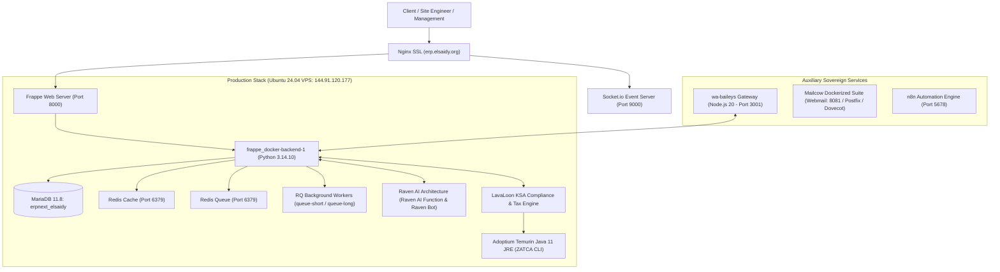

# Elsaidy ERP — Technical Architecture Documentation
## وثيقة المعمارية الفنية لمنظومة الصعيدي لإدارة المقاولات

---

## 1. System Overview | نظرة عامة على المعمارية

Elsaidy ERP is an enterprise-grade ERP solution built on **Frappe Framework v16** and **ERPNext v16**, customized for Saudi Arabian contracting, general construction, and civil engineering companies. The primary production entity is **ركن سبل الافق** (Abbreviation: `Rkn`, legal commercial name: *شركة ركن سبل الأفق المحدودة*).

### High-Level Topology:

---

## 2. Verified Application Stack & Manifest

| Application | Installed Version | Repository Source | Architectural Purpose |
| :--- | :---: | :--- | :--- |
| **frappe** | `16.54.0` | `github.com/frappe/frappe` | Underlying web framework, ORM, authentication, and REST APIs. |
| **erpnext** | `16.53.0` | `github.com/frappe/erpnext` | Core ERP modules: General Ledger, Accounts, Assets, Projects, Purchasing, Sales. |
| **hrms** | `16.53.0` | `github.com/frappe/hrms` | HR management, payroll processing, employee advances, and custody links. |
| **raven** | `3.2.0` | `github.com/frappe/raven` | AI Assistant and contextual chat platform. |
| **ksa_compliance** | `0.62.0` | `github.com/LavaLoon/ksa_compliance` | Official ZATCA Phase 2 compliance upstream engine. |
| **whatsapp** | `1.2.0` | `github.com/frappe/whatsapp` | Native Frappe WhatsApp notifications and webhooks. |
| **crm** | `1.90.0` | `github.com/frappe/crm` | Tender management, opportunities, and client relations. |
| **helpdesk** | `1.31.1` | `github.com/frappe/helpdesk` | Field site issue tracking, equipment ticketing, and maintenance. |
| **insights** | `3.15.1` | `github.com/frappe/insights` | Business intelligence dashboards and visual SQL reporting. |
| **builder** | `1.36.5` | `github.com/frappe/builder` | Visual page and form designer. |
| **wiki** | `3.4.0` | `github.com/frappe/wiki` | Internal company documentation and standard operating procedures (SOPs). |
| **telephony** | `0.0.1` | `github.com/frappe/telephony` | Unified communication integration. |
| **hagag_erp** | `0.0.1` | `github.com/AliAhmedElseidy/hagag-erp` | Saudi contracting suite, WhatsApp hub, Raven extensions, and ZATCA tax rules. |

---

## 3. Raven AI Architecture (Zero Vendor Modification)

### Historical Challenge:
Previous implementations attempted to inject custom accounting behaviors into Raven by monkey-patching `apps/raven/raven/ai/agents_integration.py` in memory during `after_migrate`, or mounting local patch files into vendor directories. This caused runtime instability across RQ worker restarts and posed serious deployment blockers.

### Implemented Solution (Native DocType Integration):
Raven integration is now 100% native and persistent across process restarts without modifying any vendor file:
1. **Registered DocTypes:** Financial tools are registered directly via Frappe's standard `Raven AI Function` records with `type = "Custom Function"`.
2. **Bot Linking:** Tools are linked to `Raven Bot: Accounting` through the standard `bot_functions` child table.
3. **Registered Accounting Tools:**
   - `get_chart_of_accounts_tree`: Live chart of accounts inspection with balances.
   - `get_cost_centers_tree`: Project and operational cost centers hierarchy.
   - `get_projects_list`: Active construction sites and project codes.
   - `get_gl_balance`: Accurate real-time General Ledger balances.
   - `create_draft_journal_entry`: Balanced, validated double-entry draft creation.
4. **Safety Mechanisms:**
   - **Dry-Run Preview:** All generative financial actions return a memory-only operation preview (`OP-PREV_...`) requiring explicit confirmation before touching MariaDB.
   - **Programmatic Intent Shield:** Deterministic logic layer that overrides and corrects LLM prompt misclassifications.
   - **Zero Zero-Tax Default:** Strictly rejects transactions lacking clear tax classification.

---

## 4. WhatsApp Hub Command Center

### Architecture & Network Flow:
- **Node.js Baileys Bridge:** Runs in dedicated container `wa-baileys` on internal port `3001` (bound to `127.0.0.1:3001` and internal docker network).
- **Session Persistence:** Persistent pairing keys and cryptographic states stored in volume `/root/wa-baileys/session`.
- **Dynamic Secret Storage:** Authentication uses dynamic Bearer tokens stored in MariaDB encrypted store (`Elsaidy WhatsApp Hub`) via `get_hub_auth_token()`.
- **Zero Plaintext Token Exposure:** Hardcoded tokens (`HAGAG_WA_...`) have been completely purged from source code and logs.

### Security Layers:
1. **Strict Allowlist:** Verified against `tabElsaidy WhatsApp Contact Rule`.
2. **Silent Drop Policy:** Unlisted numbers receive zero response, leaking no bot existence or financial metadata.
3. **Cloud LID Resolution:** Maps phone numbers to WhatsApp Cloud Linked Device IDs (LID) for 1-to-1 chats, preventing Signal protocol ratchet decryption errors.
4. **Deduplication Engine:** In-memory and database tracking prevents duplicate notifications for single financial vouchers.

---

## 5. Saudi Contracting & Tax Engine (IPC & Article 50)

### 1. Interim Payment Certificate (IPC) Engine:
Defined in `hagag_erp/tax_engine.py`:
- **Taxable Base:** Gross certified work minus approved advance payment recovery.
- **Retention Guarantee:** 10% (Commercial) or 5% (Government Etimad). **Retention does not reduce the taxable base**.
- **VAT Calculation:** 15% calculated strictly on the taxable base prior to retention deductions.
- **Time of Supply:**
  - Private contracts: `certification_date` (approval of IPC).
  - Government contracts: `payment_date` (issuance of Etimad payment order).

### 2. Article 50 Input VAT Recovery Rules:
- **Commercial Heavy Machinery (Excavators, Loaders, Cranes, Dump Trucks):** 100% input VAT recoverable, mapped to account `1510 - ضريبة القيمة المضافة للمدخلات 15% - Rkn`.
- **Restricted Passenger Vehicles (Administrative Sedans):** Input VAT capitalized onto vehicle expense or mapped to non-recoverable tax account `5235`.
- **Pending/Unverified Invoices:** Directed to `1520 - ضريبة مدخلات معلقة تحت المراجعة - Rkn` with hard block on submission (`validate_tax_review_before_submit`).

---

## 6. ZATCA Phase 2 Compliance Architecture

### Implementation:
- **Upstream Engine:** LavaLoon KSA Compliance (`v0.62.0`).
- **JRE Environment:** `ops/Dockerfile.zatca` built with `Adoptium Temurin OpenJDK 11 JRE` with verified SHA-256 checksum.
- **Cryptographic Keys:** ECDSA secp256k1 keypair generation, CSR issuance, and persistent site-level storage (`./sites/erp.local/zatca-files/`).
- **Document Pipeline:** UBL 2.1 XML generation -> SHA-256 hashing -> Digital Signature -> TLV QR Code generation -> API transmission to ZATCA Gateway.

### Production Onboarding Roadmap:
Technical readiness is 100% complete and tested in staging. Official production onboarding requires:
1. Company Tax ID (15 digits) and CR number entered in Company DocType.
2. Authorized representative logs into ZATCA Fatoora Portal to generate a 6-digit one-time onboarding OTP.
3. Execution of production CSID enrollment command.

---

## 7. Security, Backup & Rollback Engineering

### Multi-Tier Backup:
- Automated daily snapshots via `bench backup --with-files`.
- Encrypted configuration preservation (`site_config.json` containing `encryption_key`).
- Off-site backup copy stored outside VPS infrastructure.

### Tested Emergency Rollback Protocol:
A strict 6-step runbook verified on staging:
1. Site Maintenance Mode enabled (`set-maintenance-mode on`).
2. Pre-rollback emergency snapshot taken (`backup --with-files`).
3. Gzip file integrity verified (`gzip -t`).
4. Controlled database & files restoration with explicit DB root credentials (`restore --db-root-password ... --force`).
5. Git commit/tag rollback (`git checkout <stable_tag>`).
6. Cache clearing, maintenance mode deactivation, and background worker restart.

---

## 8. Modularity & Future Feature Extension Guide

To ensure future enhancements are safely decoupled from core accounting:
1. **Feature Branching:** Develop new capabilities in isolated feature branches (`feat/<feature-name>`).
2. **Hook-Based Registration:** Register new APIs and integrations via `hooks.py` entry points rather than modifying vendor modules.
3. **Database Independence:** Separate operational logs from transactional accounting tables (`tabGL Entry`).
4. **Planned Enhancements:**
   - Multi-modal WhatsApp AI (Voice memo parsing, PDF receipt extraction).
   - Arabic voice synthesized responses.
   - Advanced subcontracting milestone tracking and retention release automation.
